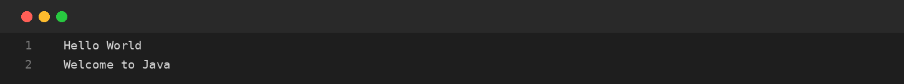
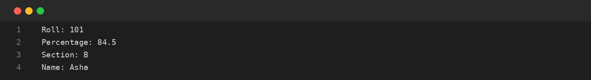
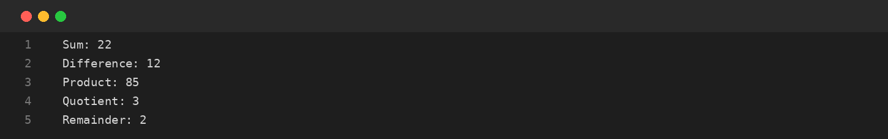

# Assignment-01: HELLO WORLD, VARIABLES AND ARITHMETIC
**Course Code:** BCS351 | **Subject:** Introduction to Programming Using Java Lab
**Student:** SACHIN (Student ID: BCS2025424, Section: E)
**University:** Invertis University, Bareilly

---

## Aim
Print text, store values in variables and perform arithmetic operations.

## Software / Tools Required
Java Development Kit (JDK), Java IDE or text editor (such as VS Code / IntelliJ IDEA / Notepad), and Command Prompt / Terminal.

## Theory
Java programs use the main() method as the entry point. Variables store values of different data types such as int, double, char and String. Arithmetic operators perform addition, subtraction, multiplication, division and remainder. The final keyword is used to declare a constant.

## Algorithm / Procedure
- **Task 1** – Print two welcome messages.
- **Task 2** – Declare and display variables.
- **Task 3** – Perform arithmetic operations.
- **Task 4** – Calculate area and perimeter of a circle.

---

## Program / Queries / Commands & Output

### Task 1 – Print two welcome messages

**Source File:** [`task1_welcome_messages.java`](task1_welcome_messages.java)

```java
public class task1_welcome_messages {
    public static void main(String[] args) {
        System.out.println("Hello World");
        System.out.println("Welcome to Java");
    }
}
```

#### Output Preview:



```text
Hello World
Welcome to Java
```

### Task 2 – Declare and display variables

**Source File:** [`task2_variables.java`](task2_variables.java)

```java
public class task2_variables {
    public static void main(String[] args) {
        int roll = 101;
        double percentage = 84.5;
        char section = 'B';
        String name = "Asha";
        System.out.println("Roll: " + roll);
        System.out.println("Percentage: " + percentage);
        System.out.println("Section: " + section);
        System.out.println("Name: " + name);
    }
}
```

#### Output Preview:



```text
Roll: 101
Percentage: 84.5
Section: B
Name: Asha
```

### Task 3 – Perform arithmetic operations

**Source File:** [`task3_arithmetic_operations.java`](task3_arithmetic_operations.java)

```java
public class task3_arithmetic_operations {
    public static void main(String[] args) {
        int a = 17, b = 5;
        System.out.println("Sum: " + (a + b));
        System.out.println("Difference: " + (a - b));
        System.out.println("Product: " + (a * b));
        System.out.println("Quotient: " + (a / b));
        System.out.println("Remainder: " + (a % b));
    }
}
```

#### Output Preview:



```text
Sum: 22
Difference: 12
Product: 85
Quotient: 3
Remainder: 2
```

### Task 4 – Calculate area and perimeter of a circle

**Source File:** [`task4_circle_area_perimeter.java`](task4_circle_area_perimeter.java)

```java
public class task4_circle_area_perimeter {
    public static void main(String[] args) {
        final double PI = 3.14;
        double radius = 7;
        System.out.println("Area: " + (PI * radius * radius));
        System.out.println("Perimeter: " + (2 * PI * radius));
    }
}
```

#### Output Preview:


```text
Area: 153.86
Perimeter: 43.96
```

---

## Input / Test Data
Values and strings are initialized in the program as specified in the assignment.

## Result
Thus, the experiment 'HELLO WORLD, VARIABLES AND ARITHMETIC' was performed using Java. The programs were written, compiled, executed, and the expected outputs were obtained.

---

## Viva-Voce Questions with Answers

**Q. What is a variable?**  
*Ans.* A variable is a named memory location used to store a value.

**Q. What is the difference between int and double?**  
*Ans.* int stores whole numbers, while double stores decimal numbers.

**Q. What does the final keyword do?**  
*Ans.* It declares a value that cannot be reassigned after initialization.

