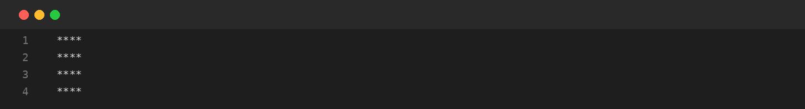
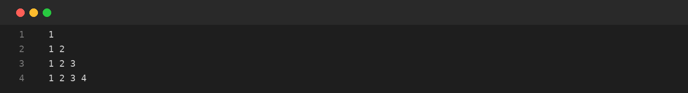

# Assignment-03: STAR AND NUMBER PATTERNS
**Course Code:** BCS351 | **Subject:** Introduction to Programming Using Java Lab
**Student:** SACHIN (Student ID: BCS2025424, Section: E)
**University:** Invertis University, Bareilly

---

## Aim
Use nested loops to print star and number patterns in rows.

## Software / Tools Required
Java Development Kit (JDK), Java IDE or text editor (such as VS Code / IntelliJ IDEA / Notepad), and Command Prompt / Terminal.

## Theory
A nested loop is a loop placed inside another loop. The outer loop controls the rows, while the inner loop controls the items printed in each row. System.out.print() keeps output on the same line, and System.out.println() moves to the next line.

## Algorithm / Procedure
- **Task 1** – Print a 4 by 4 square of stars.
- **Task 2** – Print a right triangle of stars.
- **Task 3** – Print a number triangle.
- **Task 4** – Print an upside-down triangle of stars.

---

## Program / Queries / Commands & Output

### Task 1 – Print a 4 by 4 square of stars

**Source File:** [`task1_square_star_pattern.java`](task1_square_star_pattern.java)

```java
public class task1_square_star_pattern {
    public static void main(String[] args) {
        for (int i = 1; i <= 4; i++) {
            for (int j = 1; j <= 4; j++) System.out.print("*");
            System.out.println();
        }
    }
}
```

#### Output Preview:



```text
****
****
****
****
```

### Task 2 – Print a right triangle of stars

**Source File:** [`task2_right_triangle_star.java`](task2_right_triangle_star.java)

```java
public class task2_right_triangle_star {
    public static void main(String[] args) {
        for (int i = 1; i <= 4; i++) {
            for (int j = 1; j <= i; j++) System.out.print("*");
            System.out.println();
        }
    }
}
```

#### Output Preview:


```text
*
**
***
****
```

### Task 3 – Print a number triangle

**Source File:** [`task3_number_triangle.java`](task3_number_triangle.java)

```java
public class task3_number_triangle {
    public static void main(String[] args) {
        for (int i = 1; i <= 4; i++) {
            for (int j = 1; j <= i; j++) System.out.print(j + " ");
            System.out.println();
        }
    }
}
```

#### Output Preview:



```text
1 
1 2 
1 2 3 
1 2 3 4
```

### Task 4 – Print an upside-down triangle of stars

**Source File:** [`task4_inverted_triangle_star.java`](task4_inverted_triangle_star.java)

```java
public class task4_inverted_triangle_star {
    public static void main(String[] args) {
        for (int i = 4; i >= 1; i--) {
            for (int j = 1; j <= i; j++) System.out.print("*");
            System.out.println();
        }
    }
}
```

#### Output Preview:


```text
****
***
**
*
```

---

## Input / Test Data
Values and strings are initialized in the program as specified in the assignment.

## Result
Thus, the experiment 'STAR AND NUMBER PATTERNS' was performed using Java. The programs were written, compiled, executed, and the expected outputs were obtained.

---

## Viva-Voce Questions with Answers

**Q. What is a nested loop?**  
*Ans.* A loop written inside another loop.

**Q. What is the use of println()?**  
*Ans.* It prints text and moves to the next line.

**Q. What controls the rows in a pattern?**  
*Ans.* Usually the outer loop controls the rows.

