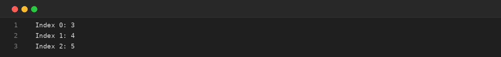
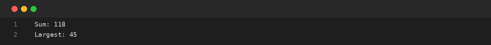
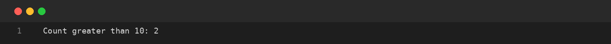

# Assignment-05: ARRAYS: TRAVERSAL AND COUNTING
**Course Code:** BCS351 | **Subject:** Introduction to Programming Using Java Lab
**Student:** SACHIN (Student ID: BCS2025424, Section: E)
**University:** Invertis University, Bareilly

---

## Aim
Create arrays, visit every element, calculate totals and count values.

## Software / Tools Required
Java Development Kit (JDK), Java IDE or text editor (such as VS Code / IntelliJ IDEA / Notepad), and Command Prompt / Terminal.

## Theory
An array stores multiple values of the same data type in a single variable. Array indexing starts at zero. The length property gives the number of elements. A for loop can traverse an array and update variables such as sum, largest value and count.

## Algorithm / Procedure
- **Task 1** – Display array elements with their indexes.
- **Task 2** – Find sum and largest array value.
- **Task 3** – Count values greater than 10.

---

## Program / Queries / Commands & Output

### Task 1 – Display array elements with their indexes

**Source File:** [`task1_array_traversal.java`](task1_array_traversal.java)

```java
public class task1_array_traversal {
    public static void main(String[] args) {
        int[] arr = {3, 4, 5};
        for (int i = 0; i < arr.length; i++) {
            System.out.println("Index " + i + ": " + arr[i]);
        }
    }
}
```

#### Output Preview:



```text
Index 0: 3
Index 1: 4
Index 2: 5
```

### Task 2 – Find sum and largest array value

**Source File:** [`task2_sum_and_largest.java`](task2_sum_and_largest.java)

```java
public class task2_sum_and_largest {
    public static void main(String[] args) {
        int[] arr = {12, 45, 7, 33, 21};
        int sum = 0, largest = arr[0];
        for (int x : arr) {
            sum += x;
            if (x > largest) largest = x;
        }
        System.out.println("Sum: " + sum);
        System.out.println("Largest: " + largest);
    }
}
```

#### Output Preview:



```text
Sum: 118
Largest: 45
```

### Task 3 – Count values greater than 10

**Source File:** [`task3_count_greater_than_10.java`](task3_count_greater_than_10.java)

```java
public class task3_count_greater_than_10 {
    public static void main(String[] args) {
        int[] arr = {5, 12, 2, 14, 7};
        int count = 0;
        for (int x : arr) if (x > 10) count++;
        System.out.println("Count greater than 10: " + count);
    }
}
```

#### Output Preview:



```text
Count greater than 10: 2
```

---

## Input / Test Data
Values and strings are initialized in the program as specified in the assignment.

## Result
Thus, the experiment 'ARRAYS: TRAVERSAL AND COUNTING' was performed using Java. The programs were written, compiled, executed, and the expected outputs were obtained.

---

## Viva-Voce Questions with Answers

**Q. What is an array?**  
*Ans.* An array stores multiple values of the same type.

**Q. What is the first index of an array?**  
*Ans.* The first index is 0.

**Q. What does arr.length return?**  
*Ans.* It returns the number of elements in the array.

