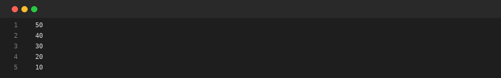
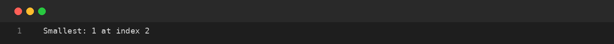
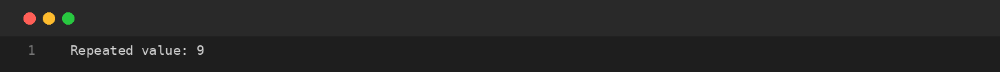

# Assignment-06: ARRAYS: REVERSE AND DUPLICATES
**Course Code:** BCS351 | **Subject:** Introduction to Programming Using Java Lab
**Student:** SACHIN (Student ID: BCS2025424, Section: E)
**University:** Invertis University, Bareilly

---

## Aim
Print arrays in reverse, locate the smallest element and detect repeated values.

## Software / Tools Required
Java Development Kit (JDK), Java IDE or text editor (such as VS Code / IntelliJ IDEA / Notepad), and Command Prompt / Terminal.

## Theory
Array elements can be accessed using their indexes. Reverse traversal starts from arr.length - 1 and moves towards index zero. Nested loops can compare each pair of elements to find duplicates.

## Algorithm / Procedure
- **Task 1** – Print array in reverse order.
- **Task 2** – Find the smallest value and its index.
- **Task 3** – Check for a repeated value.

---

## Program / Queries / Commands & Output

### Task 1 – Print array in reverse order

**Source File:** [`task1_reverse_array.java`](task1_reverse_array.java)

```java
public class task1_reverse_array {
    public static void main(String[] args) {
        int[] arr = {10, 20, 30, 40, 50};
        for (int i = arr.length - 1; i >= 0; i--) {
            System.out.println(arr[i]);
        }
    }
}
```

#### Output Preview:



```text
50
40
30
20
10
```

### Task 2 – Find the smallest value and its index

**Source File:** [`task2_smallest_and_index.java`](task2_smallest_and_index.java)

```java
public class task2_smallest_and_index {
    public static void main(String[] args) {
        int[] arr = {2, 5, 1, 8, 3, 4};
        int smallest = arr[0], index = 0;
        for (int i = 1; i < arr.length; i++) {
            if (arr[i] < smallest) { smallest = arr[i]; index = i; }
        }
        System.out.println("Smallest: " + smallest + " at index " + index);
    }
}
```

#### Output Preview:



```text
Smallest: 1 at index 2
```

### Task 3 – Check for a repeated value

**Source File:** [`task3_find_duplicate.java`](task3_find_duplicate.java)

```java
public class task3_find_duplicate {
    public static void main(String[] args) {
        int[] arr = {4, 9, 2, 9, 7};
        boolean found = false;
        for (int i = 0; i < arr.length; i++) {
            for (int j = i + 1; j < arr.length; j++) {
                if (arr[i] == arr[j]) {
                    System.out.println("Repeated value: " + arr[i]);
                    found = true; break;
                }
            }
            if (found) break;
        }
        if (!found) System.out.println("No repeated value");
    }
}
```

#### Output Preview:



```text
Repeated value: 9
```

---

## Input / Test Data
Values and strings are initialized in the program as specified in the assignment.

## Result
Thus, the experiment 'ARRAYS: REVERSE AND DUPLICATES' was performed using Java. The programs were written, compiled, executed, and the expected outputs were obtained.

---

## Viva-Voce Questions with Answers

**Q. How is reverse traversal performed?**  
*Ans.* By starting at the last index and moving towards index zero.

**Q. What is a duplicate value?**  
*Ans.* A value that occurs more than once.

**Q. Why are nested loops useful here?**  
*Ans.* They allow each element to be compared with other elements.

