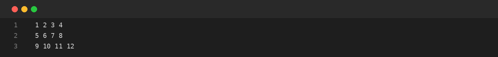
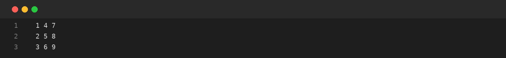
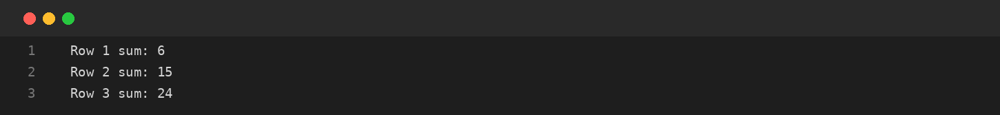

# Assignment-08: MATRICES: TRANSPOSE AND ROW SUMS
**Course Code:** BCS351 | **Subject:** Introduction to Programming Using Java Lab
**Student:** SACHIN (Student ID: BCS2025424, Section: E)
**University:** Invertis University, Bareilly

---

## Aim
Create two-dimensional arrays, print matrices, transpose them and calculate row sums.

## Software / Tools Required
Java Development Kit (JDK), Java IDE or text editor (such as VS Code / IntelliJ IDEA / Notepad), and Command Prompt / Terminal.

## Theory
A two-dimensional array stores data in rows and columns. Two indexes are used to access an element: the row index and the column index. Nested loops are commonly used to visit every matrix element. The transpose of a matrix is formed by interchanging its rows and columns.

## Algorithm / Procedure
- **Task 1** – Create and print a 3 by 4 matrix.
- **Task 2** – Print the transpose of a matrix.
- **Task 3** – Calculate the sum of each row.

---

## Program / Queries / Commands & Output

### Task 1 – Create and print a 3 by 4 matrix

**Source File:** [`task1_create_and_print_matrix.java`](task1_create_and_print_matrix.java)

```java
public class task1_create_and_print_matrix {
    public static void main(String[] args) {
        int[][] m = new int[3][4];
        int value = 1;
        for (int i = 0; i < 3; i++) {
            for (int j = 0; j < 4; j++) {
                m[i][j] = value++;
                System.out.print(m[i][j] + " ");
            }
            System.out.println();
        }
    }
}
```

#### Output Preview:



```text
1 2 3 4 
5 6 7 8 
9 10 11 12
```

### Task 2 – Print the transpose of a matrix

**Source File:** [`task2_matrix_transpose.java`](task2_matrix_transpose.java)

```java
public class task2_matrix_transpose {
    public static void main(String[] args) {
        int[][] m = {{1, 2, 3}, {4, 5, 6}, {7, 8, 9}};
        for (int i = 0; i < 3; i++) {
            for (int j = 0; j < 3; j++) System.out.print(m[j][i] + " ");
            System.out.println();
        }
    }
}
```

#### Output Preview:



```text
1 4 7 
2 5 8 
3 6 9
```

### Task 3 – Calculate the sum of each row

**Source File:** [`task3_matrix_row_sums.java`](task3_matrix_row_sums.java)

```java
public class task3_matrix_row_sums {
    public static void main(String[] args) {
        int[][] m = {{1, 2, 3}, {4, 5, 6}, {7, 8, 9}};
        for (int i = 0; i < 3; i++) {
            int sum = 0;
            for (int j = 0; j < 3; j++) sum += m[i][j];
            System.out.println("Row " + (i + 1) + " sum: " + sum);
        }
    }
}
```

#### Output Preview:



```text
Row 1 sum: 6
Row 2 sum: 15
Row 3 sum: 24
```

---

## Input / Test Data
Values and strings are initialized in the program as specified in the assignment.

## Result
Thus, the experiment 'MATRICES: TRANSPOSE AND ROW SUMS' was performed using Java. The programs were written, compiled, executed, and the expected outputs were obtained.

---

## Viva-Voce Questions with Answers

**Q. What is a 2D array?**  
*Ans.* An array organized in rows and columns.

**Q. What is a matrix transpose?**  
*Ans.* A matrix formed by interchanging rows and columns.

**Q. How are matrix elements accessed?**  
*Ans.* Using two indexes: row and column.

