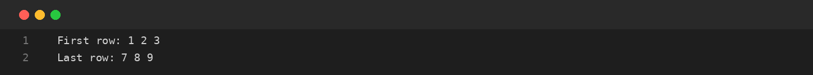
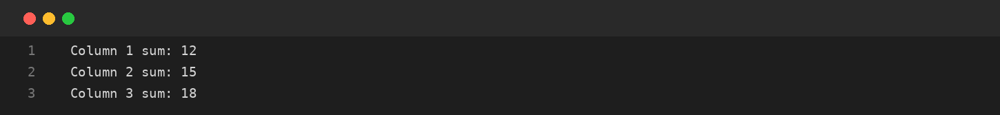
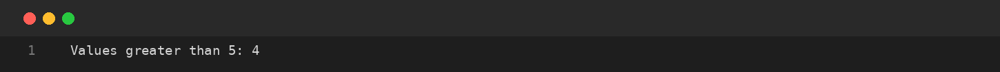

# Assignment-09: MATRICES: ROWS AND COLUMNS
**Course Code:** BCS351 | **Subject:** Introduction to Programming Using Java Lab
**Student:** SACHIN (Student ID: BCS2025424, Section: E)
**University:** Invertis University, Bareilly

---

## Aim
Use nested loops to display matrix rows, calculate column sums and count selected values.

## Software / Tools Required
Java Development Kit (JDK), Java IDE or text editor (such as VS Code / IntelliJ IDEA / Notepad), and Command Prompt / Terminal.

## Theory
Matrix elements are accessed using m[row][column]. To calculate a column sum, the column index remains fixed while the row index changes. Conditions can be used inside nested loops to count values that satisfy a requirement.

## Algorithm / Procedure
- **Task 1** – Display the first and last row.
- **Task 2** – Calculate the sum of each column.
- **Task 3** – Count matrix values greater than 5.

---

## Program / Queries / Commands & Output

### Task 1 – Display the first and last row

**Source File:** [`task1_first_and_last_row.java`](task1_first_and_last_row.java)

```java
public class task1_first_and_last_row {
    public static void main(String[] args) {
        int[][] m = {{1, 2, 3}, {4, 5, 6}, {7, 8, 9}};
        System.out.print("First row: ");
        for (int x : m[0]) System.out.print(x + " ");
        System.out.println();
        System.out.print("Last row: ");
        for (int x : m[2]) System.out.print(x + " ");
    }
}
```

#### Output Preview:



```text
First row: 1 2 3 
Last row: 7 8 9
```

### Task 2 – Calculate the sum of each column

**Source File:** [`task2_column_sums.java`](task2_column_sums.java)

```java
public class task2_column_sums {
    public static void main(String[] args) {
        int[][] m = {{1, 2, 3}, {4, 5, 6}, {7, 8, 9}};
        for (int j = 0; j < 3; j++) {
            int sum = 0;
            for (int i = 0; i < 3; i++) sum += m[i][j];
            System.out.println("Column " + (j + 1) + " sum: " + sum);
        }
    }
}
```

#### Output Preview:



```text
Column 1 sum: 12
Column 2 sum: 15
Column 3 sum: 18
```

### Task 3 – Count matrix values greater than 5

**Source File:** [`task3_count_matrix_greater_than_5.java`](task3_count_matrix_greater_than_5.java)

```java
public class task3_count_matrix_greater_than_5 {
    public static void main(String[] args) {
        int[][] m = {{1, 2, 3}, {4, 5, 6}, {7, 8, 9}};
        int count = 0;
        for (int[] row : m)
            for (int x : row) if (x > 5) count++;
        System.out.println("Values greater than 5: " + count);
    }
}
```

#### Output Preview:



```text
Values greater than 5: 4
```

---

## Input / Test Data
Values and strings are initialized in the program as specified in the assignment.

## Result
Thus, the experiment 'MATRICES: ROWS AND COLUMNS' was performed using Java. The programs were written, compiled, executed, and the expected outputs were obtained.

---

## Viva-Voce Questions with Answers

**Q. How do you calculate a column sum?**  
*Ans.* Keep the column index fixed and add elements while changing the row index.

**Q. What does m[i][j] represent?**  
*Ans.* The element at row i and column j.

**Q. What is a nested loop used for in matrices?**  
*Ans.* To visit rows and columns.

