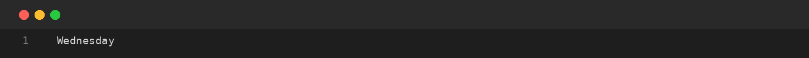
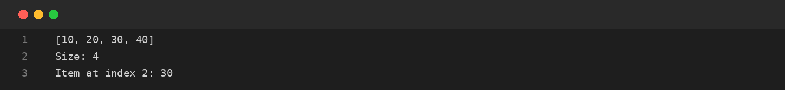
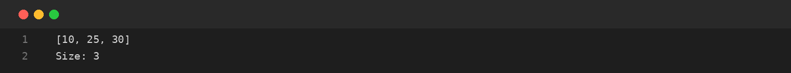

# Assignment-10: SWITCH AND ARRAYLIST
**Course Code:** BCS351 | **Subject:** Introduction to Programming Using Java Lab
**Student:** SACHIN (Student ID: BCS2025424, Section: E)
**University:** Invertis University, Bareilly

---

## Aim
Use switch to select a case and use ArrayList to store, access and modify values.

## Software / Tools Required
Java Development Kit (JDK), Java IDE or text editor (such as VS Code / IntelliJ IDEA / Notepad), and Command Prompt / Terminal.

## Theory
The switch statement selects one case from several possible values. ArrayList is a resizable collection from the java.util package. add() inserts an element, size() returns the number of elements, get() reads an element, set() replaces an element and remove() deletes an element.

## Algorithm / Procedure
- **Task 1** – Display a day using switch.
- **Task 2** – Create and access an ArrayList.
- **Task 3** – Update and remove ArrayList elements.

---

## Program / Queries / Commands & Output

### Task 1 – Display a day using switch

**Source File:** [`task1_day_switch.java`](task1_day_switch.java)

```java
public class task1_day_switch {
    public static void main(String[] args) {
        int day = 3;
        switch (day) {
            case 1: System.out.println("Monday"); break;
            case 2: System.out.println("Tuesday"); break;
            case 3: System.out.println("Wednesday"); break;
            default: System.out.println("Invalid day");
        }
    }
}
```

#### Output Preview:



```text
Wednesday
```

### Task 2 – Create and access an ArrayList

**Source File:** [`task2_create_arraylist.java`](task2_create_arraylist.java)

```java
import java.util.ArrayList;

public class task2_create_arraylist {
    public static void main(String[] args) {
        ArrayList<Integer> list = new ArrayList<>();
        list.add(10); list.add(20); list.add(30); list.add(40);
        System.out.println(list);
        System.out.println("Size: " + list.size());
        System.out.println("Item at index 2: " + list.get(2));
    }
}
```

#### Output Preview:



```text
[10, 20, 30, 40]
Size: 4
Item at index 2: 30
```

### Task 3 – Update and remove ArrayList elements

**Source File:** [`task3_update_remove_arraylist.java`](task3_update_remove_arraylist.java)

```java
import java.util.ArrayList;

public class task3_update_remove_arraylist {
    public static void main(String[] args) {
        ArrayList<Integer> list = new ArrayList<>();
        list.add(10); list.add(20); list.add(30); list.add(40);
        list.set(1, 25);
        list.remove(3);
        System.out.println(list);
        System.out.println("Size: " + list.size());
    }
}
```

#### Output Preview:



```text
[10, 25, 30]
Size: 3
```

---

## Input / Test Data
Values and strings are initialized in the program as specified in the assignment.

## Result
Thus, the experiment 'SWITCH AND ARRAYLIST' was performed using Java. The programs were written, compiled, executed, and the expected outputs were obtained.

---

## Viva-Voce Questions with Answers

**Q. What is a switch statement?**  
*Ans.* A selection statement that executes a matching case.

**Q. What is ArrayList?**  
*Ans.* A resizable collection in Java.

**Q. What does get(index) do?**  
*Ans.* It returns the element at the specified index.

