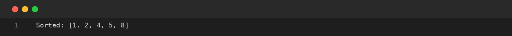
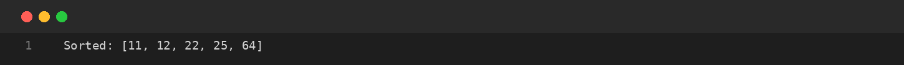
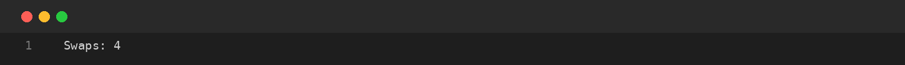

# Assignment-11: BUBBLE SORT AND SELECTION SORT
**Course Code:** BCS351 | **Subject:** Introduction to Programming Using Java Lab
**Student:** SACHIN (Student ID: BCS2025424, Section: E)
**University:** Invertis University, Bareilly

---

## Aim
Sort arrays in increasing order using bubble sort and selection sort, and count swaps.

## Software / Tools Required
Java Development Kit (JDK), Java IDE or text editor (such as VS Code / IntelliJ IDEA / Notepad), and Command Prompt / Terminal.

## Theory
Sorting arranges data in a particular order. Bubble sort repeatedly compares adjacent elements and swaps them when they are in the wrong order. Selection sort finds the smallest remaining element and places it at the current position. A swap exchanges the values stored at two indexes.

## Algorithm / Procedure
- **Task 1** – Sort an array using bubble sort.
- **Task 2** – Sort an array using selection sort.
- **Task 3** – Count swaps in bubble sort.

---

## Program / Queries / Commands & Output

### Task 1 – Sort an array using bubble sort

**Source File:** [`task1_bubble_sort.java`](task1_bubble_sort.java)

```java
import java.util.Arrays;

public class task1_bubble_sort {
    public static void main(String[] args) {
        int[] a = {5, 1, 4, 2, 8};
        for (int i = 0; i < a.length - 1; i++) {
            for (int j = 0; j < a.length - 1 - i; j++) {
                if (a[j] > a[j + 1]) {
                    int t = a[j]; a[j] = a[j + 1]; a[j + 1] = t;
                }
            }
        }
        System.out.println("Sorted: " + Arrays.toString(a));
    }
}
```

#### Output Preview:



```text
Sorted: [1, 2, 4, 5, 8]
```

### Task 2 – Sort an array using selection sort

**Source File:** [`task2_selection_sort.java`](task2_selection_sort.java)

```java
import java.util.Arrays;

public class task2_selection_sort {
    public static void main(String[] args) {
        int[] a = {64, 25, 12, 22, 11};
        for (int i = 0; i < a.length - 1; i++) {
            int min = i;
            for (int j = i + 1; j < a.length; j++)
                if (a[j] < a[min]) min = j;
            int t = a[i]; a[i] = a[min]; a[min] = t;
        }
        System.out.println("Sorted: " + Arrays.toString(a));
    }
}
```

#### Output Preview:



```text
Sorted: [11, 12, 22, 25, 64]
```

### Task 3 – Count swaps in bubble sort

**Source File:** [`task3_bubble_sort_swaps.java`](task3_bubble_sort_swaps.java)

```java
public class task3_bubble_sort_swaps {
    public static void main(String[] args) {
        int[] a = {5, 1, 4, 2, 8};
        int swaps = 0;
        for (int i = 0; i < a.length - 1; i++) {
            for (int j = 0; j < a.length - 1 - i; j++) {
                if (a[j] > a[j + 1]) {
                    int t = a[j]; a[j] = a[j + 1]; a[j + 1] = t;
                    swaps++;
                }
            }
        }
        System.out.println("Swaps: " + swaps);
    }
}
```

#### Output Preview:



```text
Swaps: 4
```

---

## Input / Test Data
Values and strings are initialized in the program as specified in the assignment.

## Result
Thus, the experiment 'BUBBLE SORT AND SELECTION SORT' was performed using Java. The programs were written, compiled, executed, and the expected outputs were obtained.

---

## Viva-Voce Questions with Answers

**Q. What is sorting?**  
*Ans.* Arranging data in a specified order.

**Q. How does bubble sort work?**  
*Ans.* It compares adjacent elements and swaps them when needed.

**Q. What does selection sort select?**  
*Ans.* The smallest remaining element in each pass.

