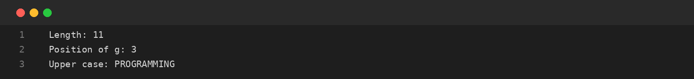
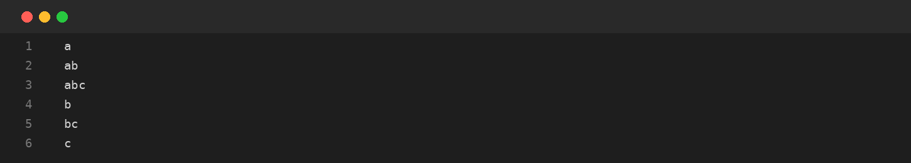

# Assignment-13: STRINGS: METHODS AND PALINDROMES
**Course Code:** BCS351 | **Subject:** Introduction to Programming Using Java Lab
**Student:** SACHIN (Student ID: BCS2025424, Section: E)
**University:** Invertis University, Bareilly

---

## Aim
Use String methods, reverse words, check palindromes and generate substrings.

## Software / Tools Required
Java Development Kit (JDK), Java IDE or text editor (such as VS Code / IntelliJ IDEA / Notepad), and Command Prompt / Terminal.

## Theory
String is a sequence of characters in Java. Strings are immutable. length() returns the number of characters, indexOf() finds a character position, toUpperCase() converts letters to uppercase, charAt() accesses a character and substring() extracts part of a string. A palindrome reads the same forwards and backwards.

## Algorithm / Procedure
- **Task 1** – Use common String methods.
- **Task 2** – Reverse a word using charAt.
- **Task 3** – Check whether a word is a palindrome.
- **Task 4** – Print all substrings of a word.

---

## Program / Queries / Commands & Output

### Task 1 – Use common String methods

**Source File:** [`task1_string_methods.java`](task1_string_methods.java)

```java
public class task1_string_methods {
    public static void main(String[] args) {
        String s = "Programming";
        System.out.println("Length: " + s.length());
        System.out.println("Position of g: " + s.indexOf('g'));
        System.out.println("Upper case: " + s.toUpperCase());
    }
}
```

#### Output Preview:



```text
Length: 11
Position of g: 3
Upper case: PROGRAMMING
```

### Task 2 – Reverse a word using charAt

**Source File:** [`task2_reverse_string.java`](task2_reverse_string.java)

```java
public class task2_reverse_string {
    public static void main(String[] args) {
        String s = "Java", reversed = "";
        for (int i = s.length() - 1; i >= 0; i--)
            reversed += s.charAt(i);
        System.out.println("Reversed: " + reversed);
    }
}
```

#### Output Preview:


```text
Reversed: avaJ
```

### Task 3 – Check whether a word is a palindrome

**Source File:** [`task3_check_palindrome.java`](task3_check_palindrome.java)

```java
public class task3_check_palindrome {
    public static void main(String[] args) {
        String s = "racecar";
        String reversed = "";
        for (int i = s.length() - 1; i >= 0; i--) reversed += s.charAt(i);
        if (s.equals(reversed)) System.out.println(s + " is a palindrome");
        else System.out.println(s + " is not a palindrome");
    }
}
```

#### Output Preview:


```text
racecar is a palindrome
```

### Task 4 – Print all substrings of a word

**Source File:** [`task4_substrings.java`](task4_substrings.java)

```java
public class task4_substrings {
    public static void main(String[] args) {
        String s = "abc";
        for (int i = 0; i < s.length(); i++)
            for (int j = i + 1; j <= s.length(); j++)
                System.out.println(s.substring(i, j));
    }
}
```

#### Output Preview:



```text
a
ab
abc
b
bc
c
```

---

## Input / Test Data
Values and strings are initialized in the program as specified in the assignment.

## Result
Thus, the experiment 'STRINGS: METHODS AND PALINDROMES' was performed using Java. The programs were written, compiled, executed, and the expected outputs were obtained.

---

## Viva-Voce Questions with Answers

**Q. Are Java Strings mutable?**  
*Ans.* No, String objects are immutable.

**Q. What does length() return?**  
*Ans.* The number of characters in the string.

**Q. What is a palindrome?**  
*Ans.* A word that reads the same forwards and backwards.

