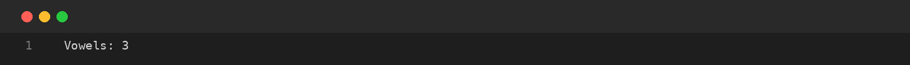
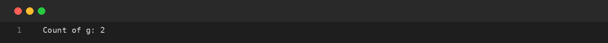
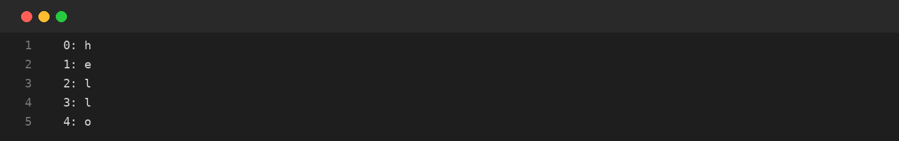

# Assignment-14: CHARACTERS: COUNTING AND POSITIONS
**Course Code:** BCS351 | **Subject:** Introduction to Programming Using Java Lab
**Student:** SACHIN (Student ID: BCS2025424, Section: E)
**University:** Invertis University, Bareilly

---

## Aim
Use charAt() to count vowels and selected letters, and display character positions.

## Software / Tools Required
Java Development Kit (JDK), Java IDE or text editor (such as VS Code / IntelliJ IDEA / Notepad), and Command Prompt / Terminal.

## Theory
The charAt(index) method returns the character at a specified zero-based position in a String. A loop can inspect every character. A counter variable can be increased whenever a character matches a required condition.

## Algorithm / Procedure
- **Task 1** – Count vowels in a string.
- **Task 2** – Count occurrences of the letter g.
- **Task 3** – Print each character with its position.

---

## Program / Queries / Commands & Output

### Task 1 – Count vowels in a string

**Source File:** [`task1_count_vowels.java`](task1_count_vowels.java)

```java
public class task1_count_vowels {
    public static void main(String[] args) {
        String s = "programming";
        int count = 0;
        for (int i = 0; i < s.length(); i++) {
            char c = s.charAt(i);
            if (c == 'a' || c == 'e' || c == 'i' || c == 'o' || c == 'u') count++;
        }
        System.out.println("Vowels: " + count);
    }
}
```

#### Output Preview:



```text
Vowels: 3
```

### Task 2 – Count occurrences of the letter g

**Source File:** [`task2_count_letter_g.java`](task2_count_letter_g.java)

```java
public class task2_count_letter_g {
    public static void main(String[] args) {
        String s = "programming";
        int count = 0;
        for (int i = 0; i < s.length(); i++)
            if (s.charAt(i) == 'g') count++;
        System.out.println("Count of g: " + count);
    }
}
```

#### Output Preview:



```text
Count of g: 2
```

### Task 3 – Print each character with its position

**Source File:** [`task3_character_positions.java`](task3_character_positions.java)

```java
public class task3_character_positions {
    public static void main(String[] args) {
        String s = "hello";
        for (int i = 0; i < s.length(); i++)
            System.out.println(i + ": " + s.charAt(i));
    }
}
```

#### Output Preview:



```text
0: h
1: e
2: l
3: l
4: o
```

---

## Input / Test Data
Values and strings are initialized in the program as specified in the assignment.

## Result
Thus, the experiment 'CHARACTERS: COUNTING AND POSITIONS' was performed using Java. The programs were written, compiled, executed, and the expected outputs were obtained.

---

## Viva-Voce Questions with Answers

**Q. What does charAt() do?**  
*Ans.* It returns the character at a specified index.

**Q. Do String indexes start at zero?**  
*Ans.* Yes, Java String indexes are zero-based.

**Q. How can vowels be counted?**  
*Ans.* Traverse the string and increment a counter when a character is a vowel.

