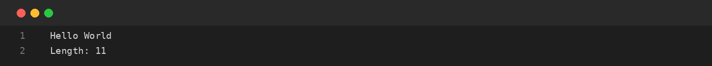

# Assignment-15: STRINGBUILDER METHODS
**Course Code:** BCS351 | **Subject:** Introduction to Programming Using Java Lab
**Student:** SACHIN (Student ID: BCS2025424, Section: E)
**University:** Invertis University, Bareilly

---

## Aim
Build and modify text using append(), insert() and deleteCharAt().

## Software / Tools Required
Java Development Kit (JDK), Java IDE or text editor (such as VS Code / IntelliJ IDEA / Notepad), and Command Prompt / Terminal.

## Theory
StringBuilder represents a mutable sequence of characters. Unlike String, its contents can be changed without creating a new object for every modification. append() adds text at the end, insert() adds text at a specified index and deleteCharAt() removes a character at a given index.

## Algorithm / Procedure
- **Task 1** – Append text and display its length.
- **Task 2** – Append numbers and remove the last comma.
- **Task 3** – Insert text at the beginning.

---

## Program / Queries / Commands & Output

### Task 1 – Append text and display its length

**Source File:** [`task1_append_and_length.java`](task1_append_and_length.java)

```java
public class task1_append_and_length {
    public static void main(String[] args) {
        StringBuilder sb = new StringBuilder("Hello");
        sb.append(" World");
        System.out.println(sb);
        System.out.println("Length: " + sb.length());
    }
}
```

#### Output Preview:



```text
Hello World
Length: 11
```

### Task 2 – Append numbers and remove the last comma

**Source File:** [`task2_append_and_delete.java`](task2_append_and_delete.java)

```java
public class task2_append_and_delete {
    public static void main(String[] args) {
        StringBuilder sb = new StringBuilder();
        for (int i = 1; i <= 5; i++) sb.append(i).append(",");
        sb.deleteCharAt(sb.length() - 1);
        System.out.println(sb);
    }
}
```

#### Output Preview:


```text
1,2,3,4,5
```

### Task 3 – Insert text at the beginning

**Source File:** [`task3_insert_at_beginning.java`](task3_insert_at_beginning.java)

```java
public class task3_insert_at_beginning {
    public static void main(String[] args) {
        StringBuilder sb = new StringBuilder("Java");
        sb.insert(0, "Hello ");
        System.out.println(sb);
    }
}
```

#### Output Preview:


```text
Hello Java
```

---

## Input / Test Data
Values and strings are initialized in the program as specified in the assignment.

## Result
Thus, the experiment 'STRINGBUILDER METHODS' was performed using Java. The programs were written, compiled, executed, and the expected outputs were obtained.

---

## Viva-Voce Questions with Answers

**Q. What is StringBuilder?**  
*Ans.* A mutable sequence of characters.

**Q. What does append() do?**  
*Ans.* It adds text at the end.

**Q. What does deleteCharAt() do?**  
*Ans.* It removes the character at the specified index.

